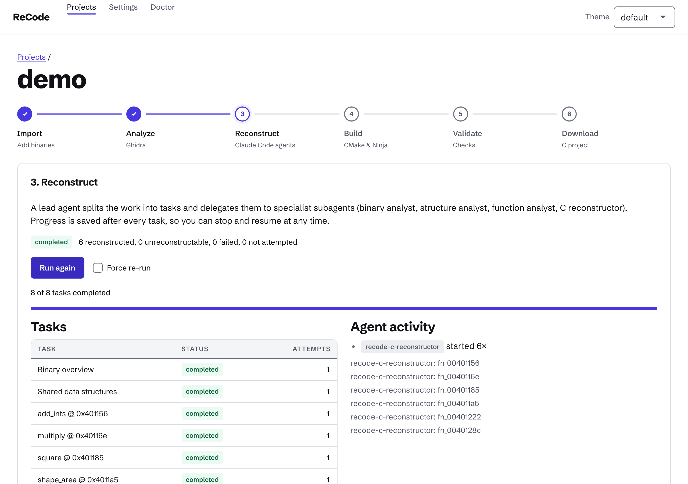

# ReCode

ReCode is a **local, open-source command-line tool** for reverse engineering and C code reconstruction. It combines
[Ghidra](https://ghidra-sre.org/) (analysis and decompilation) with the [Claude Code](https://code.claude.com/) CLI
(AI agents) and turns a binary into a buildable C project:

```
Binary → Detection → Ghidra analysis → AI reconstruction → CMake/Ninja build → Validation
```

Everything runs on your machine. There is no ReCode server, no account, no database and no API key: Claude Code is
used through the locally installed CLI with your own login, and all projects and results are plain files in a project
directory.

> **Honest expectations.** Original source code cannot be recovered exactly from a binary. ReCode produces a
> best-effort reconstruction, labels every inference as _certain_, _probable_ or _speculative_, and states clearly
> what was **not** verified. A successful build does not mean the reconstruction behaves like the original.

## Features

- **Format detection by content** (magic bytes and parsed headers, not file extensions): ELF, PE (EXE/DLL), Mach-O
  (including universal binaries, split per slice), COFF object files, raw binaries, ZIP archives.
- Extracts architecture, bitness, endianness, entry point, sections, segments and symbols from the file itself.
- **Safe ZIP extraction**: path traversal, symlinks, ZIP bombs, size/file-count limits, encrypted and corrupt entries.
- **Ghidra headless integration**: functions, references, call graph, symbols, data types, assembly and decompiler
  output exported as validated JSON.
- **Claude Code agents** (lead agent plus five specialists) using Claude Code's native subagents, with a configurable
  concurrency limit (default 2), no shell access, and writes restricted to `reconstruction/`.
- **C project generation** with headers, per-function source files documenting address, confidence and assumptions.
- **CMake + Ninja build** with compiler diagnostics mapped back to the responsible function; `reconstruct --repair`
  sends build errors back to the agents.
- **Resumable workflows**: per-step state, per-function task state, atomic JSON writes, crash recovery, idempotent steps.
- Optional **AI review** (validation agent) and a validation report that distinguishes syntax, compilation,
  coverage, functional equivalence and fidelity (the last two are reported as _not assessed_ in this version).

## Requirements

| Tool                                      | Needed for                          |
| ----------------------------------------- | ----------------------------------- |
| Node.js ≥ 20 (LTS recommended), npm       | running ReCode                      |
| Ghidra (recent release) and a JDK ≥ 21    | `recode analyze`                    |
| Claude Code CLI, logged in with your plan | `recode reconstruct`, `--ai-review` |
| C compiler (gcc/clang), CMake, Ninja      | `recode build`                      |

Run `recode doctor` to check them. Details: [docs/installation.md](docs/installation.md). Linux and macOS are the
supported platforms; Windows is untested (see limitations).

## Installation

```bash
git clone <this repository> recode && cd recode
npm install
npm run build
npm link            # makes the "recode" command available
recode doctor
```

## Quick start

```bash
recode init demo && cd demo
recode import ../sample-program          # or a ZIP, PE, Mach-O, .bin (see below)
recode inspect                           # facts from the file headers
recode run                               # analyze → reconstruct → build → validate
recode status
```

Or step by step, re-running any step at will (finished steps with unchanged inputs are skipped; use `--force`):

```bash
recode analyze
recode reconstruct --parallel 2          # resumes after interruption
recode build
recode reconstruct --repair              # only if the build had errors, then: recode build
recode validate [--ai-review]
```

Results: `analysis/<id>/` (Ghidra JSON, decompiled C, assembly), `source/<id>/` (the generated C project incl.
`RECONSTRUCTION.md`), `build/<id>/`, `reconstruction/<id>/` (agent results, validation report).

## Web interface

`recode ui` starts a local web UI (127.0.0.1 only, random access token) with a step-by-step wizard, live progress,
settings and doctor. See [docs/web-ui.md](docs/web-ui.md).



## Commands

| Command                      | Purpose                                                                                                       |
| ---------------------------- | ------------------------------------------------------------------------------------------------------------- |
| `recode init <name>`         | Create a project directory (with agent definitions in `.claude/`)                                             |
| `recode import <path>`       | Import a binary, ZIP archive or reference file. Raw binaries: `--raw --arch --endian --bits --base [--entry]` |
| `recode inspect`             | Show format, architecture, sections, symbols (`--json`, `--symbols`)                                          |
| `recode analyze`             | Run Ghidra headless and export structured results                                                             |
| `recode reconstruct`         | AI reconstruction (`--parallel`, `--batch-size`, `--retry-failed`, `--repair`, `--force`)                     |
| `recode build`               | Configure with CMake, build with Ninja, collect diagnostics                                                   |
| `recode validate`            | Evaluate results (`--ai-review` for the validation agent)                                                     |
| `recode run`                 | Run all steps in order, resuming where it stopped                                                             |
| `recode status`              | Workflow steps, task counts (`--json`)                                                                        |
| `recode logs`                | ReCode log, or tool transcripts (`--list`, `--file`, `-n`)                                                    |
| `recode doctor`              | Check required tools and the Claude Code login                                                                |
| `recode config get/set/list` | Configuration (project level, or `--global`)                                                                  |

Global options: `--project <dir>` (otherwise the nearest parent containing `recode.json`), `--verbose`.
Exit codes: `0` ok, `1` failure, `2` invalid usage/input, `3` missing prerequisite, `4` project problem,
`5` external tool failed, `130` cancelled.

## Supported input

| Input                                 | Support                                                                                                 |
| ------------------------------------- | ------------------------------------------------------------------------------------------------------- |
| ELF (executable, shared, relocatable) | Full header, section, segment, symbol parsing                                                           |
| PE (EXE, DLL), PE32 and PE32+         | Headers, sections, export table (no import table, no .NET handling)                                     |
| Mach-O, universal binaries            | Thin images, load commands, symbols; universal binaries are split into one binary per slice             |
| COFF object files (`.obj`)            | Structural detection (no magic number), sections and symbols                                            |
| Raw binaries (`.bin`, or `--raw`)     | Architecture, endianness, bits, base address (and optional entry) must be supplied by the user          |
| ZIP archives                          | Stored/deflate, no ZIP64, no encryption, no nested archives; binaries inside are imported               |
| Reference material                    | `.c .cc .cpp .cxx .h .hpp .json .yaml .yml .txt .md .map .sym` – stored in `reference/`, never executed |

## Configuration

Layers (later wins): defaults → `~/.config/recode/config.json` → project (`recode.json`) → environment
(`GHIDRA_INSTALL_DIR`, `RECODE_CLAUDE_COMMAND`). Examples:

```bash
recode config set claude.maxParallelAgents 3
recode config set tools.ghidraInstallDir /opt/ghidra_11.3_PUBLIC --global
recode config list
```

## Security model

Binaries are **never executed** by ReCode. Analyzed content (strings, symbols, decompiler output, reference files) is
treated as untrusted: agents run without a shell (`Bash`, web tools removed), in Claude Code's `dontAsk` permission
mode, may write only below `reconstruction/<binary>/`, ignore user-level Claude settings (`--setting-sources project`)
and are told that binary-derived text is data, not instructions. Processes are started without a shell, with timeouts,
and their whole process tree is terminated on abort. See [docs/architecture.md](docs/architecture.md#security).

## Known limitations

See [docs/architecture.md](docs/architecture.md#limitations) for the full list. The most important ones:

- **The Ghidra export script (`ExportAnalysis.java`) has not been run against a real Ghidra yet** in the environment
  where this version was developed (no network access to download Ghidra). The adapter and all file formats are
  covered by tests with a command-line-compatible fake; run `npm run test:ghidra` against your installation to verify
  it, and please report problems.
- The agent session with the real Claude Code CLI is covered by an optional live test (`npm run test:claude`); the
  default test suite uses a mock CLI so it never needs a subscription.
- Functional equivalence and fidelity cannot be verified in this version (reported as _not assessed_).
- The subagent concurrency limit is given to the lead agent as an instruction; Claude Code has no hard cap for it.
- Windows is untested.

## License

MIT.
